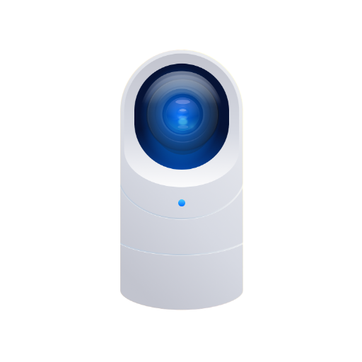

**unifi-protect**

***

<SPAN ALIGN="CENTER" STYLE="text-align:center">
<DIV ALIGN="CENTER" STYLE="text-align:center">

[](https://github.com/hjdhjd/unifi-protect)

# UniFi Protect API

[](https://www.npmjs.com/package/unifi-protect)
[](https://www.npmjs.com/package/unifi-protect)

## A complete UniFi Protect API implementation.
</DIV>
</SPAN>

`unifi-protect` is a library that enables you to connect to and communicate with the Ubiquiti UniFi Protect API and ecosystem. [UniFi Protect](https://ui.com/camera-security) is [Ubiquiti's](https://www.ui.com) next-generation video security platform, with rich camera, doorbell, and NVR controller hardware options for you to choose from, as well as an app which you can use to view, configure and manage your video camera and doorbells.

## Getting started

`ProtectClient.connect()` is the one entry point. It logs in, fetches the initial bootstrap, opens the realtime events channel, and returns a fully-ready client - or throws a typed error. Every long-lived object is an `AsyncDisposable`, so `await using` cleans everything up at scope exit.

```ts
import { ProtectClient } from "unifi-protect";

await using client = await ProtectClient.connect({ host: "192.168.1.1", password: "password", username: "protect-user" });

// Devices are live projections over the current state.
for(const camera of client.cameras) {

  console.log(camera.name, camera.isOnline ? "online" : "offline");
}

// The realtime firehose is an async iterable of typed events.
for await (const event of client.events({ signal })) {

  if(event.kind === "motionDetected") {

    console.log("Motion on", event.cameraId);
  }
}
```

The [`ufp` CLI](https://github.com/hjdhjd/unifi-protect/tree/main/src/util/cli) is the canonical reference consumer - it exercises every API surface against real hardware. Read it to see the library in practice.

## Why use this library for UniFi Protect support?
In short - because I use it every day to support a very popular [Homebridge](https://homebridge.io) plugin named [homebridge-unifi-protect](https://www.npmjs.com/package/homebridge-unifi-protect) that I maintain. I have been occasionally asked if I would consider packaging the core API library separately from the plugin so that other open source projects can take advantage of the work that's been done here to understand and decode the UniFi Protect API.

In addition, this implementation is unique: it's the first complete open source implementation of the realtime UniFi Protect update API, enabling instantaneous updates to Protect-related events. It's also the first (and to my knowledge only) complete implementation of the livestream API provided by UniFi Protect. Note: this is **not** the RTSP URLs that are provided by UniFi Protect controllers, but rather, true access to the encoded video datastream (H.264, HEVC, or AV1) for any camera connected to the Protect controller.

Finally - the most significant reason that you should use this library: it's very well-tested, it is modern, and most importantly, *it just works*. It's quite easy to add support for UniFi Protect in your project using this library, and you can rely on the fact that the code is used by a significant population of users out there who ensure its continued robustness.

### <A NAME="protect-contribute"></A>How you can contribute and make this library even better
This implementation is largely feature complete. I strive to add support for meaningful features to a broad groups of people in order to avoid any unnecessary cruft and technical debt that may accrue over time.

The UniFi Protect API is undocumented and implementing a library like this one is the result of many hours of trial and error as well as community support.

## Utilities

| Name | Description |
| ------ | ------ |
| [Clock](interfaces/Clock.md) | Source of time for any code that needs to know "what time is it now?", "how much time has passed?", "wake me up after a delay," or "call me back once the time is up." Every timer and timestamp in the library reads time through this interface, never through `Date.now()`, `process.hrtime`, `node:timers/promises`, or the global `setTimeout` directly. Tests substitute a controllable clock to drive time deterministically without real-time waits or module-level mocking. Outside it by design are undici's own timers - its connect timer, the retry interceptor's backoff, and the pool's client lifetime - which are the dependency's, armed on the platform's timers inside undici where no injected clock reaches, and the `ufp` CLI, a consumer of the library that reads ambient time as any consumer does. |
| [ProtectLogging](interfaces/ProtectLogging.md) | Logging interface, leveraging what we do for Homebridge and elsewhere as a good template. |
| [noopLog](variables/noopLog.md) | The default logger every subsystem falls back to when a consumer injects none. It discards every message at every level. |
| [wallClock](variables/wallClock.md) | The production clock. Reads wall-clock time via `Date.now()`, the monotonic clock via `process.hrtime.bigint()` truncated to whole microseconds and read in milliseconds, delays via `node:timers/promises`, and arms callback timers on the global `setTimeout`. This shim is the single bridge between the `Clock` interface and Node's runtime; consumers always go through `Clock`, never directly to the Node primitives, so an unmocked call site behaves exactly like a direct `Date.now()`, `process.hrtime.bigint()`, `node:timers/promises`, or `setTimeout` call would - except past the platform timer's ceiling, where the platform would fire at once and this clock fires when asked, and at an infinite span, which the platform would fire at once and this clock never fires. |
| [formatErrorChain](functions/formatErrorChain.md) | Render an arbitrary thrown value as clean text, carrying every further diagnosis its `cause` chain holds. An `Error` surfaces its `message`; anything else is coerced through `String(...)`. |
| [isControllerRefusal](functions/isControllerRefusal.md) | Whether a failure is the controller refusing in a way that asking again sooner cannot change: a refused identity or privilege, as [isSignInRefusal](functions/isSignInRefusal.md) reads one, or a refused request rate, the HTTP 429 the transport classifies as a [ProtectRequestError](classes/ProtectRequestError.md). In each the controller answered, and its answer stands until a person corrects the credentials or the privilege, or the controller lifts its limit, so a caller retrying a connection waits for any of them on the slower `PROTECT_RECOVERY_REFUSAL_SCHEDULE_MS` rather than at the pace it keeps for a controller it cannot reach. The library's own recovery chooses its schedule by this reading, so a connect retry that branches on it walks that schedule for exactly the failures recovery walks it for. |
| [isMacAddress](functions/isMacAddress.md) | Whether a value is a hardware address. The accepted spellings are the six pairs joined by colons, the twelve digits run together, the six pairs joined by hyphens, and the three quads joined by dots, in either case. |
| [isPlainObject](functions/isPlainObject.md) | Whether a value is a plain object: a non-null object whose prototype is the ordinary object prototype or null, the shape parsed JSON gives a record. |
| [isSignInRefusal](functions/isSignInRefusal.md) | Whether a failure is the controller refusing the sign-in, on either ground: the identity itself, which the transport classifies as a [ProtectAuthError](classes/ProtectAuthError.md), or a privilege the identity lacks, which it classifies as a [ProtectAuthorizationError](classes/ProtectAuthorizationError.md). It is the narrower reading of a refusal, and it chooses the library's refused announcement, because nothing changes until a person corrects the credentials or the privilege. It chooses no schedule: a caller retrying a connection chooses its schedule by [isControllerRefusal](functions/isControllerRefusal.md), which reads a refused sign-in and a rate limit alike. |
| [maskAddressCredentials](functions/maskAddressCredentials.md) | Mask the userinfo a controller address can carry, for a message or a log line that names the address: an address carrying no `@` is returned as given, and otherwise everything up to and including its last `@` is shown as `***@`, an empty marker (`@nvr.local`) included. Every refusal of the controller address is a [ProtectConfigurationError](classes/ProtectConfigurationError.md), and each refusal that names the address quotes it through this mask, so a consumer naming the address in its own log applies the library's own rule. |
| [normalizeMacAddress](functions/normalizeMacAddress.md) | Fold a hardware address into the library's single spelling of it: uppercase, with no separators. Every spelling [isMacAddress](functions/isMacAddress.md) accepts folds the same way, whether the digits are joined by colons, by hyphens, by dots, or by nothing at all. |

## Client

| Name | Description |
| ------ | ------ |
| [ProtectClient](classes/ProtectClient.md) | The UniFi Protect client. Construct via [ProtectClient.connect](classes/ProtectClient.md#connect). |
| [ConnectionEvents](interfaces/ConnectionEvents.md) | The events [ConnectionMonitor](interfaces/ConnectionMonitor.md) publishes on its state, controller-lifecycle, and throttle rails. |
| [ConnectionMonitor](interfaces/ConnectionMonitor.md) | The connection-state coordinator. Constructed by `ProtectClient.connect()`; consumers read it as `client.connection`. |
| [ConnectionTransition](interfaces/ConnectionTransition.md) | One edge of the connection-state machine, yielded by [ConnectionMonitor.observe](interfaces/ConnectionMonitor.md#observe) and carried on the `stateChanged` event. `reason` is present when a typed fault (a stall, a failed liveness probe) drove the edge, and it holds that failure's whole cause chain as [formatErrorChain](functions/formatErrorChain.md) renders it, so the controller's own diagnosis reaches a consumer rather than the wrapper's sentence alone: the edge into `lost` renders its fault exactly as the lost line logs it. |
| [ConnectOptions](interfaces/ConnectOptions.md) | Options for [ProtectClient.connect](classes/ProtectClient.md#connect). `host`, `username`, and `password` are the required controller address and credentials. |
| [LivestreamSubscribeOptions](interfaces/LivestreamSubscribeOptions.md) | Per-subscription options for `LivestreamPool.subscribe` (reached through the [Camera.livestream](interfaces/Camera.md#livestream) consumer entry point). All optional: a bare `subscribe(spec)` is a resilient, drain-on-dispose subscription with no abort wiring and no reported urgency. |
| [LivestreamSubscription](interfaces/LivestreamSubscription.md) | A consumer's handle into a pooled livestream. It is an `AsyncIterable<Segment>` (the iterator *is* the surface - no callback rail) and `AsyncDisposable`. Each subscription has its **own unbounded queue**: the pool pushes every segment to every subscriber, so one slow consumer cannot stall a fast one, and nothing is dropped. |
| [LivestreamSubscriptionStats](interfaces/LivestreamSubscriptionStats.md) | The delivery counters a [LivestreamSubscription](interfaces/LivestreamSubscription.md) exposes, so a consumer can monitor its own slowness (a growing `queueDepth` / `peakQueueDepth`) and respond - the only backpressure mechanism, since the queue itself is unbounded. |
| [ProtectClientEvents](interfaces/ProtectClientEvents.md) | The events the [ProtectClient](classes/ProtectClient.md) publishes. `packet` is the realtime event firehose - the same `TypedEvent` stream that feeds the reducer, fanned out to consumers. It is produced by the realtime events WebSocket and bridged here at the composition root: each decoded event is dispatched into the store and then emitted on this rail from the one bridge subscription, so there is a single decode path for both the state model and the firehose. |
| [RecoveryContext](interfaces/RecoveryContext.md) | What the library can observe at a recovery decision point. Consumer-private state (buffer headroom, controller health) is deliberately *not* here - a consumer that wants to correlate recovery with controller health reads it in its own policy closure. The fields are exactly what the library itself can compute. |
| [ThrottleSource](interfaces/ThrottleSource.md) | The narrow Transport surface the monitor depends on - exactly the throttle verdict and the two throttle rails, nothing more. Expressing the dependency as this structural type (rather than the concrete [Transport](interfaces/Transport.md)) is what makes the contract's "narrow coupling to Transport" a compile-time guarantee: the monitor cannot reach into the transport's request path or breaker internals because the type does not expose them. The concrete `Transport` satisfies this structurally. |
| [ConnectionState](type-aliases/ConnectionState.md) | The connection's observable state. `healthy` is steady operation; `degraded` means a fault was detected and reachability is being probed; `reconnecting` means the controller is reachable and the monitor is re-bootstrapping and relaunching the events stream; `lost` means the controller is unreachable, is refusing the sign-in or is limiting the request rate, and recovery is retrying on the schedule that cause calls for; `throttled` means the transport's circuit breaker is open (HTTP is paused on a cooldown). `throttled` is derived live from the transport and takes precedence. |
| [LivestreamSubscriptionState](type-aliases/LivestreamSubscriptionState.md) | The coarse, stable lifecycle of a pooled stream as a subscriber observes it. `connecting` is bounded establishment (no MEDIA segment has ever flowed); `live` is a healthy stream; `recovering` is an in-flight recovery episode (a recoverable stall shows here *without* ending iteration); `closed` is terminal (disposed, codec change, or the policy gave up). |
| [RecoveryDecision](type-aliases/RecoveryDecision.md) | A recovery decision the [RecoveryPolicy](type-aliases/RecoveryPolicy.md) returns. Its arms are exhaustive: |
| [RecoveryPolicy](type-aliases/RecoveryPolicy.md) | The single decision authority for a stream's recovery, injected at the pool (the same dependency inversion as `resolveUrl`). Pure: given the library-observable [RecoveryContext](interfaces/RecoveryContext.md), it returns a [RecoveryDecision](type-aliases/RecoveryDecision.md). The library ships [defaultLivestreamRecoveryPolicy](functions/defaultLivestreamRecoveryPolicy.md), a health-agnostic default; a consumer injects its own to add the controller-health correlation only it can observe. |
| [defaultLivestreamRecoveryPolicy](functions/defaultLivestreamRecoveryPolicy.md) | The library's default, health-agnostic recovery policy. It is **phase-split**, because establishing and recovering have different timing authorities: |

## Devices

| Name | Description |
| ------ | ------ |
| [Camera](interfaces/Camera.md) | A camera projection. Inherits the read-through getters, live `observe`, and the write-through `update` and `reboot` commands from [DeviceProjection](interfaces/DeviceProjection.md), and adds the commands specific to cameras. Camera-specific *configuration* (RTSP enablement, recording settings, and so on) is expressed through `update` payloads rather than bespoke methods. |
| [Chime](interfaces/Chime.md) | A chime projection. Inherits the read-through getters, live `observe`, and write-through `update` / `reboot` from [DeviceProjection](interfaces/DeviceProjection.md); chime *configuration* (default volume, per-camera ringtone assignment) is expressed through `update` payloads, while the things a chime can be told to *do* are first-class commands. |
| [DeviceProjection](interfaces/DeviceProjection.md) | The shared base of every *device* projection (`Camera`, `Chime`, `Fob`, `Light`, `Relay`, `Sensor`, `Viewer`). It extends the read-only [Projection](interfaces/Projection.md) core with what every device category adds: a stable `id`, the `modelKey` tag, the `name` / `isOnline` getters, and the write-through `update` and `reboot` commands (every Protect device type exposes a reboot endpoint). |
| [Fob](interfaces/Fob.md) | A fob projection. Inherits the read-through getters, live `observe`, and write-through `update` / `reboot` from [DeviceProjection](interfaces/DeviceProjection.md). A fob is an input device: its security-action button presses arrive as occurrences on the event firehose, its away/arm state (`awayState`, `pendingActionType`) is read through the device record, and its last button press time is also available synchronously via `wirelessConnectionState.functionButtonPressedAt`, so it adds no fob-specific commands. |
| [Light](interfaces/Light.md) | A light projection. Inherits the read-through getters, live `observe`, and write-through `update` / `reboot` from [DeviceProjection](interfaces/DeviceProjection.md); light-specific behavior (level, motion activation) is expressed through `update` payloads rather than bespoke methods. |
| [LivestreamOptions](interfaces/LivestreamOptions.md) | Options for [Camera.livestream](interfaces/Camera.md#livestream) - the stream-affecting `source` selector (a quality channel or a secondary lens) and tuning (segment length, chunk size, opt-in timestamps) without `cameraId` (the camera supplies its own id), plus the per-subscription [LivestreamSubscribeOptions](interfaces/LivestreamSubscribeOptions.md) (an abort signal that disposes the returned subscription, an `urgency` closure feeding the pool's resilient recovery, and `discardOnDispose`). |
| [Nvr](interfaces/Nvr.md) | The NVR projection - a read-only, observable view over the controller's configuration singleton (`state.nvr`). It is the singleton sibling of the device projections: exactly like `Camera` it is a live view whose getters read through to the current store snapshot, so a held handle always reflects the latest reduced state. It differs only in being constructed from just a context, since the NVR is a singleton with no id to bind, where `Camera` binds a `(context, id)` pair. |
| [PlaySpeakerOptions](interfaces/PlaySpeakerOptions.md) | Options for [Chime.playSpeaker](interfaces/Chime.md#playspeaker). Every field is optional. The ringtone/playback fields (`repeatTimes`, `ringtoneId`, `volume`) map 1:1 to the controller's `play-speaker` payload: omit all of them to play the chime's default assigned ringtone at the controller's chosen repeat count and volume, or supply any subset to select a specific ringtone and/or override its playback. `signal` is the client-side abort signal for the request and is never sent to the controller. |
| [Projection](interfaces/Projection.md) | The read-only core every projection shares - whether it is a command-bearing device ([DeviceProjection](interfaces/DeviceProjection.md)) or the read-only NVR singleton (`Nvr`). A projection is **a live view, not a cached entity**: it holds only its context and a stable selector, and every property access reads through to the current store snapshot. Holding a projection across hours of state change is safe - its getters always reflect the latest reduced state. |
| [Relay](interfaces/Relay.md) | A relay projection. Inherits the read-through getters, live `observe`, and write-through `update` / `reboot` from [DeviceProjection](interfaces/DeviceProjection.md), and adds its relay-specific command, [Relay.toggleOutput](interfaces/Relay.md#toggleoutput), the faithful primitive over the controller's per-output activate endpoint. |
| [Sensor](interfaces/Sensor.md) | A sensor projection. Inherits the read-through getters, live `observe`, and write-through `update` / `reboot` from [DeviceProjection](interfaces/DeviceProjection.md); sensor-specific behavior (sensitivity, mount type, thresholds) is expressed through `update` payloads. |
| [SnapshotOptions](interfaces/SnapshotOptions.md) | Options for [Camera.snapshot](interfaces/Camera.md#snapshot). Width and height request a specific output size; omit both for the controller's default. Set `packageCamera` to capture from the secondary package sensor on dual-camera devices (the G4/G5 Doorbell Pro) instead of the primary lens. |
| [Viewer](interfaces/Viewer.md) | A viewer projection. Inherits the read-through getters, live `observe`, and write-through `update` / `reboot` from [DeviceProjection](interfaces/DeviceProjection.md); viewer-specific behavior (assigned liveview) is expressed through `update` payloads. |
| [ProtectDeviceConfig](type-aliases/ProtectDeviceConfig.md) | The config-record union a device projection can wrap - every modeled device except the NVR singleton. |

## Diagnostics

| Name | Description |
| ------ | ------ |
| [AdoptionContradictionPayload](interfaces/AdoptionContradictionPayload.md) | Payload published on [channels.adoptionContradiction](variables/channels.md#property-adoptioncontradiction). `modelKey` and `id` identify the device whose record was self-contradictory; `mac` is the device's own hardware address; `nvrMac` is the owning-controller address the record asserted, kept as the wire spelled it, which names this controller's own MAC in some spelling (that identity is what makes the adopted-by-another claim provably false). The library corrects the record and publishes this once per episode; consumers building dashboards add their own counters. |
| [AuthReloginPayload](interfaces/AuthReloginPayload.md) | Payload published on [channels.authRelogin](variables/channels.md#property-authrelogin). `success` is `true` when the relogin re-established the session, and `false` when it did not: the controller refused the sign-in or accepted it without a complete session, no credentials were retained, the session was ended or replaced while the relogin ran, or the handshake failed on anything else, a failure the request that triggered the relogin then throws. |
| [ConnectionRebootDetectedPayload](interfaces/ConnectionRebootDetectedPayload.md) | Payload published on [channels.connectionRebootDetected](variables/channels.md#property-connectionrebootdetected). The controller's own self-reported boot time (`upSince`) is the underlying wire-level signal; a threshold-based comparison across bootstraps distinguishes a genuine reboot from measurement jitter in that value. |
| [ConnectionTransitionPayload](interfaces/ConnectionTransitionPayload.md) | Payload published on [channels.connectionTransition](variables/channels.md#property-connectiontransition). `reason` is present when a specific cause (a typed error, a watchdog trip) drove the transition. |
| [EventsClosedPayload](interfaces/EventsClosedPayload.md) | Payload published on [channels.eventsClosed](variables/channels.md#property-eventsclosed). When the controller closes the stream unprompted, `code` and `reason` carry the peer's WebSocket close frame. When the stream closes itself, they carry the library's own classification instead: `1000` for a deliberate teardown (an explicit `close()` or the caller's abort) and `1006` for a failure-driven one (a socket error or a watchdog stall), with a reason describing what ended it. |
| [EventsPacketPayload](interfaces/EventsPacketPayload.md) | Payload published on [channels.eventsPacket](variables/channels.md#property-eventspacket). `kind` is a `TypedEvent` tag; `modelKey` and `id` are present for device-scoped events. |
| [EventsReconnectingPayload](interfaces/EventsReconnectingPayload.md) | Payload published on [channels.eventsReconnecting](variables/channels.md#property-eventsreconnecting). `reason` is the fault that dropped the events channel, rendered with its cause chain as `formatErrorChain` renders it, or a generic description when no fault was recorded. |
| [HttpRequestEndPayload](interfaces/HttpRequestEndPayload.md) | Payload published on [channels.httpRequestEnd](variables/channels.md#property-httprequestend). `statusCode` is present when a response was received and read to its end, whatever its status, and `error` otherwise: the request failed at the transport level, before or while its response was read, or its caller cancelled it, which `cancelled` marks. |
| [HttpRequestStartPayload](interfaces/HttpRequestStartPayload.md) | Payload published on [channels.httpRequestStart](variables/channels.md#property-httprequeststart). `requestId` correlates the start with its matching [HttpRequestEndPayload](interfaces/HttpRequestEndPayload.md). |
| [HttpThrottleEnteredPayload](interfaces/HttpThrottleEnteredPayload.md) | Payload published on [channels.httpThrottleEntered](variables/channels.md#property-httpthrottleentered). `consecutiveFailures` is the count of consecutive requests the controller did not serve (no answer, a status of 500 or above, or a 429) that tripped the breaker, and `cooldownMs` is how long, in milliseconds, the transport refuses requests before it lets them through again as recovery probes. |
| [LivestreamCodecChangedPayload](interfaces/LivestreamCodecChangedPayload.md) | Payload published on [channels.livestreamCodecChanged](variables/channels.md#property-livestreamcodecchanged). `from` / `to` are the prior and the reconnected inits themselves, each with its codec label, its bytes and its description, the same pair the [ProtectCodecChangeError](classes/ProtectCodecChangeError.md) the consumer's iterator receives carries; this is its observable companion. |
| [LivestreamRecoveryExhaustedPayload](interfaces/LivestreamRecoveryExhaustedPayload.md) | Payload published on [channels.livestreamRecoveryExhausted](variables/channels.md#property-livestreamrecoveryexhausted). `attempts` is the number of consecutive failed reconnect attempts before the policy gave up. The consumer's iterator also receives a [ProtectLivestreamUnavailableError](classes/ProtectLivestreamUnavailableError.md); this channel is what an opt-in self-heal observer watches. |
| [LivestreamRecoveryRecoveredPayload](interfaces/LivestreamRecoveryRecoveredPayload.md) | Payload published on [channels.livestreamRecoveryRecovered](variables/channels.md#property-livestreamrecoveryrecovered). `downtimeMs` is the elapsed time from the fault that began the episode to the first MEDIA segment that restored the stream - liveness is media-keyed, so this measures how long media was actually absent, not how long until the controller re-acked with an init. |
| [LivestreamRecoveryStartedPayload](interfaces/LivestreamRecoveryStartedPayload.md) | Payload published on [channels.livestreamRecoveryStarted](variables/channels.md#property-livestreamrecoverystarted). `attempts` is 0 at the start of an episode; `sinceLastSegmentMs` is the time since the last segment of any kind, init segments included, when the fault was observed. It is not a measure of media downtime: an episode started by the media-stall watchdog can report a small value while media has been absent for the whole detection threshold, because non-media frames kept arriving. |
| [LivestreamSessionClosedPayload](interfaces/LivestreamSessionClosedPayload.md) | Payload published on [channels.livestreamSessionClosed](variables/channels.md#property-livestreamsessionclosed). `reason` is a short description of what ended the stream, such as its last subscriber leaving, a codec change, or the recovery policy giving up. |
| [LivestreamSessionOpenedPayload](interfaces/LivestreamSessionOpenedPayload.md) | Payload published on [channels.livestreamSessionOpened](variables/channels.md#property-livestreamsessionopened). `key` is the pool's stream-affecting sharing key `${cameraId}:${channel}:${lens}:${segmentLength}:${chunkSize}:${timestamps}` (the resolved stream-affecting identity). |
| [LivestreamStallDetectedPayload](interfaces/LivestreamStallDetectedPayload.md) | Payload published on [channels.livestreamStallDetected](variables/channels.md#property-livestreamstalldetected). `lastSegmentAt` is when the pool last saw a segment of any kind, the injected `Clock`'s `now()` read as that segment arrived, so it is epoch milliseconds only under the production clock. `silentForMs` is how long, in milliseconds, the session's heartbeat watchdog found the channel silent when it declared the stall. |
| [LivestreamSubscriptionCreatedPayload](interfaces/LivestreamSubscriptionCreatedPayload.md) | Payload published on [channels.livestreamSubscriptionCreated](variables/channels.md#property-livestreamsubscriptioncreated). |
| [LivestreamSubscriptionDisposedPayload](interfaces/LivestreamSubscriptionDisposedPayload.md) | Payload published on [channels.livestreamSubscriptionDisposed](variables/channels.md#property-livestreamsubscriptiondisposed). `stats` carries the subscription's final delivery counters, including any segments discarded on disposal. |
| [ProtectDiagnosticsChannel](interfaces/ProtectDiagnosticsChannel.md) | A diagnostics publisher bound to the payload shape it carries - the typed view of one `node:diagnostics_channel` channel. |
| [SchemaUnknownModelKeyPayload](interfaces/SchemaUnknownModelKeyPayload.md) | Payload published on [channels.schemaUnknownModelKey](variables/channels.md#property-schemaunknownmodelkey). `action` and `exampleId` are the identifying fields from the offending packet's header so a consumer can correlate the drift signal with concrete wire activity (e.g., "modelKey 'garage' first seen at action 'add' with id <uuid>"). The library does not accumulate or aggregate beyond the first-occurrence dedup; consumers building dashboards add their own counters from this channel. |
| [SchemaUnmodeledCollectionPayload](interfaces/SchemaUnmodeledCollectionPayload.md) | Payload published on [channels.schemaUnmodeledCollection](variables/channels.md#property-schemaunmodeledcollection). `collection` is the bootstrap array key (e.g. `"aiports"`), `modelKey` is the record's self-declared type (e.g. `"aiport"`), `count` is the array length, and `exampleId` is the first record's id - enough to correlate the signal with the bootstrap shape. `known` distinguishes a recognized-but-unreduced class (a model key the library knows about but does not project, `true`) from genuine schema drift the controller introduced (`false`). The library does not aggregate beyond the first-occurrence-per-`modelKey` dedup; consumers building dashboards add their own counters from this channel. |
| [TalkbackSessionClosedPayload](interfaces/TalkbackSessionClosedPayload.md) | Payload published on [channels.talkbackSessionClosed](variables/channels.md#property-talkbacksessionclosed). `reason` mirrors the WebSocket close frame's reason (or the teardown cause when the session closed itself). |
| [TalkbackSessionOpenedPayload](interfaces/TalkbackSessionOpenedPayload.md) | Payload published on [channels.talkbackSessionOpened](variables/channels.md#property-talkbacksessionopened). `cameraId` is the camera whose speaker the session connected to. |
| [AnyProtectDiagnosticsChannel](type-aliases/AnyProtectDiagnosticsChannel.md) | The element type of a subscription that spans channels carrying different payloads - the union of every channel in [channels](variables/channels.md). |
| [channels](variables/channels.md) | The library's observability surface, expressed as `node:diagnostics_channel` publishers. |
| [subscribeToChannel](functions/subscribeToChannel.md) | Attach `handler` to `channel` and return a `Disposable` that detaches it. |

## Errors

| Name | Description |
| ------ | ------ |
| [FatalError](classes/FatalError.md) | Abstract base for failures the caller should propagate. Retrying the identical call will reproduce the identical failure, so the correct response is to surface it. The exception is a [ProtectRequestError](classes/ProtectRequestError.md) carrying a status in the transport's retried set or a 429, which is the controller's readiness answer or its rate limit rather than a verdict on the call, and which a later retry can clear. |
| [ProtectAbortedError](classes/ProtectAbortedError.md) | The caller's `AbortSignal` fired. The operation was cancelled by the consumer, not by the library's own deadline. Recoverable in the sense that the caller chose to stop - re-issuing the operation with a fresh signal is valid. |
| [ProtectAuthError](classes/ProtectAuthError.md) | Authentication failed: invalid credentials, an expired session that could not be renewed, or a CSRF-token rotation that did not complete. Fatal because retrying with the same credentials reproduces the failure. |
| [ProtectAuthorizationError](classes/ProtectAuthorizationError.md) | The credentials authenticated but lack the privilege the operation requires (typically a `403`; Protect reserves many operations for administrator accounts). Fatal because the same account will keep being refused. |
| [ProtectBootstrapError](classes/ProtectBootstrapError.md) | The bootstrap sequence failed while fetching, parsing or applying the controller bootstrap document. `stage` marks which - `"fetch"` when the bootstrap endpoint returns a non-2xx status, `"parse"` when the body cannot be decoded, `"apply"` when a decoded document cannot be folded into the state model - so the caller and the diagnostics surface can report the precise point of failure rather than a generic "connect failed." A login or reachability failure is not wrapped here: a transport-level failure reaching the endpoint propagates as its own typed error (`ProtectNetworkError`, `ProtectTimeoutError`, `ProtectThrottledError`, `ProtectAbortedError`), and a login failure as `ProtectAuthError` when the controller rejected the sign-in or as `ProtectRequestError` when it answered with a status that is no verdict on the credentials (a readiness answer in the transport's retried set, a rate limit, a 3xx, or a 5xx outside the retried set). |
| [ProtectCertificateError](classes/ProtectCertificateError.md) | The controller presented a certificate the platform's verification refused. The request path and every socket raise it, so a caller reads one class wherever the refusal was met, and its sentence names the address that was dialed and the verifier's own reason. |
| [ProtectCodecChangeError](classes/ProtectCodecChangeError.md) | A pooled livestream reconnected and the controller delivered a different stream than the one in flight: its codec label or its description differs (H.264 to HEVC, a channel reconfigured mid-stream, or a sample rate, channel count or dimensions that moved under the same label). Fatal because no fixed-format consumer can adapt in place: an FFmpeg pipe cannot re-initialize, and HKSV tolerates no second init segment. The pool surfaces this as a terminal a recovering stream can raise - alongside [ProtectLivestreamUnavailableError](classes/ProtectLivestreamUnavailableError.md) when the recovery policy gives up instead - after which the consumer re-subscribes for a fresh stream against the new format. `from` and `to` are the inits themselves, each with its codec label, its bytes and its description, so a consumer can log precisely what changed. |
| [ProtectConfigurationError](classes/ProtectConfigurationError.md) | A connect option the library cannot act on, refused by `connect()` before any request is sent: a host that is missing or not a string, or a controller address no URL can carry, such as an IPv6 literal with a zone (`fe80::1%en0`), a value carrying a userinfo before its last `@`, which a host never does, or one carrying a path, a query or a fragment. An empty marker before the `@` (`@nvr.local`, `:@nvr.local`) names no account and folds away rather than being refused. Each refusal that names the address quotes it with its userinfo masked by [maskAddressCredentials](functions/maskAddressCredentials.md), so a userinfo written into the address is never printed. Fatal because the same configuration is refused the same way on every attempt, so the caller corrects it rather than retrying. |
| [ProtectError](classes/ProtectError.md) | The error model in one sentence: every failure the library raises is a subclass of [ProtectError](classes/ProtectError.md), and the *first* level of the hierarchy answers the only question a caller universally needs answered - should I retry, or should I propagate? |
| [ProtectLivestreamUnavailableError](classes/ProtectLivestreamUnavailableError.md) | A pooled livestream's recovery policy gave up. The `phase` names which regime the pool gave up in: `establishing` means no media segment arrived within the bounded establishment deadline (the stream may have connected and sent its init, but never produced media), and `recovering` means a previously-live stream could not be re-established and the policy elected to stop. Fatal because the policy - the single authority over whether to keep trying - has declared the stream unrecoverable; the consumer re-subscribes if it still wants the stream. `attempts` carries how many consecutive reconnect attempts the episode made before the policy returned `giveUp`. |
| [ProtectNetworkError](classes/ProtectNetworkError.md) | A connect, DNS, TLS, or socket-level failure reaching the controller, or a response whose bytes did not match the range or length the request expected, which the transport classifies here because the controller was reached but no whole response arrived. The originating Node `ErrnoException` is preserved on the `cause` chain (the shape undici raises as `TypeError("fetch failed", { cause: errnoError })`); `code` lifts the errno string out for convenient branching. |
| [ProtectProtocolError](classes/ProtectProtocolError.md) | A wire- or response-level violation the library cannot make sense of: an event packet that does not match the documented frame structure, a WebSocket message that breaks the spec the library decodes against, an HTTP response body that fails to parse, or a response missing data the operation requires. Fatal because the same bytes will not decode or validate differently on retry - the defect is in the payload, not in reaching it. |
| [ProtectRequestError](classes/ProtectRequestError.md) | The controller returned a non-2xx status the library does not classify more specifically (a 3xx, a 4xx other than 401/403, or any 5xx). The status, body, and headers are preserved so the caller can inspect the controller's own explanation. |
| [ProtectStallError](classes/ProtectStallError.md) | A realtime channel produced no data for longer than its heartbeat watchdog window - either the events WebSocket (silent beyond `PROTECT_EVENTS_WATCHDOG_TIMEOUT`) or a livestream session (silent beyond `PROTECT_LIVESTREAM_HEARTBEAT_TIMEOUT`). The underlying channel is presumed dead. As a `RecoverableError`, the error type itself is the signal to recover: the events stream's subscriber (the `ConnectionMonitor`) re-bootstraps and relaunches, and a stalled livestream session's owner (the pool's `ManagedSession`) drives a recovery loop that reconnects under the injected policy - the bare `LivestreamSession` escape hatch is the only livestream surface that surfaces this verbatim to a direct consumer without recovering on its behalf. |
| [ProtectThrottledError](classes/ProtectThrottledError.md) | We are inside the throttle cooldown window. The library has seen enough consecutive failures to back off from the controller, and this request was rejected locally rather than sent. Retry once the cooldown elapses. |
| [ProtectTimeoutError](classes/ProtectTimeoutError.md) | The controller did not answer in time. The request path raises it when the deadline the transport arms on its clock for each request elapses, when a connection attempt times out, and when the controller stops responding before its reply is complete; each socket raises it when its connection attempt times out. |
| [ProtectUnsupportedError](classes/ProtectUnsupportedError.md) | The requested operation is not available on this device. This is a *client-side precondition* failure - distinct from [ProtectRequestError](classes/ProtectRequestError.md), which classifies a status the controller actually returned - raised before any request is issued because the device lacks the capability the operation requires (for example, a package snapshot on a camera that has no secondary package sensor). Fatal because a device's capabilities do not change on retry; the caller should pick a different operation or device. The optional `feature` names the missing capability flag, for precise logging and programmatic branching. |
| [RecoverableError](classes/RecoverableError.md) | Abstract base for failures the caller may retry or defer. The library classifies the failure as recoverable and returns control so the caller can apply its own backoff, escalation, or alternative-path policy, and the owned HTTP pool's transparent retries of a transient answer or connection fault are the layer beneath that policy rather than a part of it. |
| [ProtectBootstrapStage](type-aliases/ProtectBootstrapStage.md) | The stages of the `connect()` sequence, used to tag a [ProtectBootstrapError](classes/ProtectBootstrapError.md). The sequence authenticates, fetches the bootstrap document, parses it, applies it, then subscribes to the realtime stream; only the fetch, parse and apply stages are wrapped as a bootstrap error. A login failure already propagates as its own typed error - `ProtectAuthError` (fatal) when the controller rejected the sign-in, `ProtectRequestError` (fatal) when it answered with a status that is no verdict on the credentials - and a reachability failure as `ProtectNetworkError` (recoverable). A failure to open the realtime subscription propagates unwrapped rather than tagged with any stage, so `"login"` and `"subscribe"` name stages of the sequence without either one being a tag a caller will observe on a thrown `ProtectBootstrapError`. |

## Events

| Name | Description |
| ------ | ------ |
| [StreamOptions](interfaces/StreamOptions.md) | Options accepted by the event-bus `stream` rail. Carries the abort signal that terminates the iteration; further keys are reserved for a future backpressure policy. The default behavior is unbounded, matching the livestream-subscription rule (a subscriber receives every emission until it aborts or stops iterating). |
| [TypedEvent](type-aliases/TypedEvent.md) | The discriminated union of every realtime event the library models, exposed on the firehose ([ProtectClient.events](classes/ProtectClient.md#events)) and by [ProtectClient.classifyPacket](classes/ProtectClient.md#classifypacket). It splits into two categories by relationship to state: |

## Other

| Name | Description |
| ------ | ------ |
| [ProtectAirQualityMetricInterface](interfaces/ProtectAirQualityMetricInterface.md) | A description of a single air quality metric reading from a UniFi Protect sensor. |
| [ProtectAirQualityThresholdSettingsInterface](interfaces/ProtectAirQualityThresholdSettingsInterface.md) | A description of threshold settings for a single air quality metric on a UniFi Protect sensor. |
| [ProtectBridgeCandidate](interfaces/ProtectBridgeCandidate.md) | A bridge candidate entry observed by a sensor. The Protect controller advertises every reachable bridge a sensor can hear, with signal-quality telemetry per candidate, so the radio-management layer can pick the best uplink. Modeled as a typed shape rather than `ProtectKnownJsonValue[]` because the field is genuinely structured...consumers reading `sensor.bridgeCandidates[0].signalQuality` get full type-checking instead of having to narrow an opaque blob at every call site. |
| [ProtectCameraChannelConfigInterface](interfaces/ProtectCameraChannelConfigInterface.md) | A semi-complete description of the UniFi Protect camera channel JSON. |
| [ProtectCameraConfigInterface](interfaces/ProtectCameraConfigInterface.md) | A semi-complete description of the UniFi Protect camera JSON. |
| [ProtectCameraLcdMessageConfigInterface](interfaces/ProtectCameraLcdMessageConfigInterface.md) | A semi-complete description of the UniFi Protect LCD message JSON. |
| [ProtectCameraRecordingPathSettingsInterface](interfaces/ProtectCameraRecordingPathSettingsInterface.md) | A description of the UniFi Protect camera recording-path settings JSON: the storage console the camera records to, whether it automatically fails over to another, and the failover timeout. |
| [ProtectCameraTalkbackConfigInterface](interfaces/ProtectCameraTalkbackConfigInterface.md) | A semi-complete description of the UniFi Protect talkback settings JSON. |
| [ProtectChimeConfigInterface](interfaces/ProtectChimeConfigInterface.md) | A semi-complete description of the UniFi Protect chime JSON. |
| [ProtectDeviceBaseInterface](interfaces/ProtectDeviceBaseInterface.md) | The common properties shared by all UniFi Protect device configuration objects. |
| [ProtectEventAddInterface](interfaces/ProtectEventAddInterface.md) | A semi-complete description of the UniFi Protect smart motion detection event JSON. |
| [ProtectEventHeader](interfaces/ProtectEventHeader.md) | The realtime-events action header. Every action frame is a JSON object carrying at least these four string fields; controllers may include arbitrary additional keys, which are preserved on the index signature. The decoder validates this shape, so a [RawPacket](interfaces/RawPacket.md)'s `header` is always trustworthy downstream. |
| [ProtectEventMetadataDetectedThumbnailInterface](interfaces/ProtectEventMetadataDetectedThumbnailInterface.md) | A semi-complete description of the UniFi Protect smart motion detection thumbnail metadata JSON. |
| [ProtectEventMetadataInterface](interfaces/ProtectEventMetadataInterface.md) | A description of metadata in UniFi Protect smart motion detect events. |
| [ProtectFobConfigInterface](interfaces/ProtectFobConfigInterface.md) | A semi-complete description of the UniFi Protect fob JSON. A fob is a long-range (LoRa) handheld with security-action buttons; it carries the standard device record (inherited from [ProtectDeviceBaseInterface](interfaces/ProtectDeviceBaseInterface.md)) plus its away/arm state, its button-label profile, any pending arm action, and its LoRa link state. It reports `host: null` and omits `isConnected`, which the shared base widens for LoRa devices. |
| [ProtectLedSettingsInterface](interfaces/ProtectLedSettingsInterface.md) | A description of a UniFi Protect device's status-LED settings. Several device classes expose the identical toggle for their indicator LED, so the shape lives here once rather than as a copy in each device's file; a class whose LED carries additional settings intersects this with them. |
| [ProtectLightConfigInterface](interfaces/ProtectLightConfigInterface.md) | A semi-complete description of the UniFi Protect light JSON. |
| [ProtectNvrAgreementInterface](interfaces/ProtectNvrAgreementInterface.md) | A description of a UniFi Protect NVR legal-agreement record: the contract identifier, its link, the contract version, and the acceptance status (`null` until the agreement is accepted). One record; [ProtectNvrAgreementsInterface](interfaces/ProtectNvrAgreementsInterface.md) is the container that holds the controller's named agreements. |
| [ProtectNvrAgreementsInterface](interfaces/ProtectNvrAgreementsInterface.md) | The container holding each of the controller's named legal agreements, every one a [ProtectNvrAgreementInterface](interfaces/ProtectNvrAgreementInterface.md) record (the singular name is one such record; this plural one is the set of them). The controller reports the identical shape at the bootstrap's top level and on the NVR record, so both reference this. |
| [ProtectNvrAiFeatureToggleInterface](interfaces/ProtectNvrAiFeatureToggleInterface.md) | A description of a UniFi Protect NVR AI-feature toggle: whether the feature is enabled and whether it applies to all cameras or only the enumerated `cameras` subset. |
| [ProtectNvrBootstrapInterface](interfaces/ProtectNvrBootstrapInterface.md) | A semi-complete description of the UniFi Protect NVR bootstrap JSON. |
| [ProtectNvrConfigInterface](interfaces/ProtectNvrConfigInterface.md) | A semi-complete description of the UniFi Protect NVR configuration JSON. |
| [ProtectNvrLiveviewConfigInterface](interfaces/ProtectNvrLiveviewConfigInterface.md) | A semi-complete description of the UniFi Protect NVR liveview JSON. |
| [ProtectNvrSystemEventControllerInterface](interfaces/ProtectNvrSystemEventControllerInterface.md) | A semi-complete description of the UniFi Protect NVR system events controller JSON. |
| [ProtectNvrSystemEventInterface](interfaces/ProtectNvrSystemEventInterface.md) | A semi-complete description of the UniFi Protect NVR system events JSON. |
| [ProtectNvrSystemInfoInterface](interfaces/ProtectNvrSystemInfoInterface.md) | A semi-complete description of the UniFi Protect NVR system information configuration JSON. |
| [ProtectNvrUserConfigInterface](interfaces/ProtectNvrUserConfigInterface.md) | A semi-complete description of the UniFi Protect NVR user JSON. |
| [ProtectOverlaySettingsInterface](interfaces/ProtectOverlaySettingsInterface.md) | A description of the UniFi Protect video-overlay settings: what the controller burns into a camera's picture, and where. The NVR carries this shape as the global default and each camera carries its own, with the camera's `useGlobalOverlaySettings` deciding which one applies - so the shape lives here once and both sites reference it. A member the NVR leaves unset is `null` there while a camera reports it populated, which is why so much of the shape is nullable. |
| [ProtectPtzAxisRangeInterface](interfaces/ProtectPtzAxisRangeInterface.md) | A description of a PTZ axis range for UniFi Protect camera feature flags. |
| [ProtectRelayConfigInterface](interfaces/ProtectRelayConfigInterface.md) | A semi-complete description of the UniFi Protect relay JSON. A relay is a long-range (LoRa) device that exposes one or more latching outputs the controller toggles individually, plus inputs that each map an external trigger to an action on one of those outputs; it carries the standard device record (inherited from [ProtectDeviceBaseInterface](interfaces/ProtectDeviceBaseInterface.md)) plus its per-output state, LoRa link state, and radio settings. It reports `host: null` and omits `isConnected`, which is why the shared base widens both - see the note on those members in the base interface. |
| [ProtectRelayInputConfigInterface](interfaces/ProtectRelayInputConfigInterface.md) | A description of a single relay input. An input maps an external trigger to an action on one of the relay's outputs; every field but the numeric `id` is reported nullable on the wire. |
| [ProtectRelayOutputConfigInterface](interfaces/ProtectRelayOutputConfigInterface.md) | A description of a single relay output. Each output is a latching switch the controller flips via the dedicated activate endpoint (see `Relay.toggleOutput`); its `state` is reported in the record and broadcast in realtime on change. The numeric `id` and the `"off" \| "on"` `state` are always present; the remaining fields are nullable on the wire. |
| [ProtectRingtoneConfigInterface](interfaces/ProtectRingtoneConfigInterface.md) | A semi-complete description of the UniFi Protect ringtone JSON. |
| [ProtectSensorAirQualityInterface](interfaces/ProtectSensorAirQualityInterface.md) | A description of the UniFi Protect sensor air-quality readings JSON. Each member is a [ProtectAirQualityMetricInterface](interfaces/ProtectAirQualityMetricInterface.md) reading for one measured quantity; a sensor without a given capability reports that metric with a `null` value. |
| [ProtectSensorAirQualitySettingsInterface](interfaces/ProtectSensorAirQualitySettingsInterface.md) | A description of the UniFi Protect sensor air-quality settings JSON: the per-metric alert thresholds (each a [ProtectAirQualityThresholdSettingsInterface](interfaces/ProtectAirQualityThresholdSettingsInterface.md)), the reading and alert intervals, the ring-LED display, the night-mode schedule, and the vape sensitivity. |
| [ProtectSensorConfigInterface](interfaces/ProtectSensorConfigInterface.md) | A semi-complete description of the UniFi Protect sensor JSON. |
| [ProtectSensorSensitivitySettingsInterface](interfaces/ProtectSensorSensitivitySettingsInterface.md) | A description of a UniFi Protect sensor sensitivity toggle - the shared shape of the sensor's motion and glass-break settings: whether the capability is enabled, its base sensitivity, and the sensitivity applied while the sensor is armed. |
| [ProtectSensorSmokeStatusInterface](interfaces/ProtectSensorSmokeStatusInterface.md) | A description of the UniFi Protect sensor smoke/CO detector status JSON. It carries the alarm and fault booleans plus the raw smoke, CO, and battery-voltage readings. |
| [ProtectSirenConfigInterface](interfaces/ProtectSirenConfigInterface.md) | A semi-complete description of the UniFi Protect siren JSON. A siren is a wired sounder the controller arms and triggers, either from its own supervised alarm input or from an automation; it carries the standard device record (inherited from [ProtectDeviceBaseInterface](interfaces/ProtectDeviceBaseInterface.md)) plus that input's wiring and the sounder's live state. It reports a concrete `host` and re-narrows it, but omits `isConnected` entirely, so that member keeps the base's optional form. It also carries the long-range radio shapes with their telemetry reported `null`, which is why those members are nullable on the shared shapes. |
| [ProtectSmartZoneInterface](interfaces/ProtectSmartZoneInterface.md) | The common properties shared by all UniFi Protect smart detection and motion zone objects. |
| [ProtectThresholdSettingsInterface](interfaces/ProtectThresholdSettingsInterface.md) | A description of threshold settings for environmental metrics (humidity, light, temperature) on a UniFi Protect sensor. |
| [ProtectViewerConfigInterface](interfaces/ProtectViewerConfigInterface.md) | A semi-complete description of the UniFi Protect viewer JSON. |
| [ProtectWifiConnectionStateInterface](interfaces/ProtectWifiConnectionStateInterface.md) | A description of the UniFi Protect device WiFi connection state JSON. |
| [ProtectWiredConnectionStateInterface](interfaces/ProtectWiredConnectionStateInterface.md) | A description of the UniFi Protect device wired connection state JSON. `phyRate` is nullable because a device with no wired link reports it as `null` (the relay, a LoRa device, carries `wiredConnectionState: { phyRate: null }`); a connected device reports the negotiated rate, as a number on most device families and as a string on some (the siren and the air-quality sensor among them). |
| [ProtectWirelessConnectionSettingsInterface](interfaces/ProtectWirelessConnectionSettingsInterface.md) | A description of the UniFi Protect device wireless (LoRa) connection settings JSON, carried by long-range radio devices such as the relay, sensors, and the fob: the paired bridge, the LoRa spreading factor and the spreading factors the device supports, and the telemetry update interval. |
| [ProtectWirelessConnectionStateInterface](interfaces/ProtectWirelessConnectionStateInterface.md) | A description of the UniFi Protect device wireless (LoRa) connection state JSON. Carried by long-range radio devices such as the relay: the live link telemetry - the battery status, the bridge it is paired with and the bridges it can hear, the last function-button press time, and the radio signal state (SNR plus signal quality and strength). The candidates are modeled inline rather than as [ProtectBridgeCandidate](interfaces/ProtectBridgeCandidate.md) because the relay's entries omit that type's required `modelKey`. |
| [RawPacket](interfaces/RawPacket.md) | The decoded, still-untyped form of a realtime-events packet: the validated action [ProtectEventHeader](interfaces/ProtectEventHeader.md) and the raw data-frame payload. The payload is `unknown` because the data frame may be parsed JSON (the dominant case), a UTF-8 string, or a raw `Buffer`; interpreting it is the classifier's job, not the codec's. It is the element type of the raw firehose (`client.rawPackets()`) and the input/output of the static `ProtectClient.decodePacket` / `ProtectClient.classifyPacket`. |
| [AuthMethod](type-aliases/AuthMethod.md) | The authentication method a doorbell [\`authDetected\`](type-aliases/TypedEvent.md) occurrence resolved: a fingerprint match or an NFC card tap. The deliberate counterpoint to [SmartDetectType](type-aliases/SmartDetectType.md): that one is *open* (`\| (string & {})`) because `objectTypes` passes wire-provided detection-class strings through verbatim and must stay honest against new firmware classes; this one is *closed*, because `method` is not passed through but *computed* by the classifier from the enumerated auth `type` values via a single map - the library can only ever produce a value it mapped, so a new auth method is an explicit extension of this union and that map together, never a silent wire passthrough. |
| [DeviceCollectionKey](type-aliases/DeviceCollectionKey.md) | The id-keyed device collections - every `DeviceModelKey` except the NVR singleton. The vocabulary the device selectors, the projections, and every per-category consumer iterate over; the innermost tier of the modelKey taxonomy. |
| [ProtectAirQualityMetric](type-aliases/ProtectAirQualityMetric.md) | - |
| [ProtectAirQualityThresholdSettings](type-aliases/ProtectAirQualityThresholdSettings.md) | - |
| [ProtectCameraChannelConfig](type-aliases/ProtectCameraChannelConfig.md) | - |
| [ProtectCameraConfig](type-aliases/ProtectCameraConfig.md) | - |
| [ProtectCameraLcdMessageConfig](type-aliases/ProtectCameraLcdMessageConfig.md) | - |
| [ProtectCameraRecordingPathSettings](type-aliases/ProtectCameraRecordingPathSettings.md) | - |
| [ProtectCameraTalkbackConfig](type-aliases/ProtectCameraTalkbackConfig.md) | - |
| [ProtectChimeConfig](type-aliases/ProtectChimeConfig.md) | - |
| [ProtectDeviceBase](type-aliases/ProtectDeviceBase.md) | - |
| [ProtectEventAdd](type-aliases/ProtectEventAdd.md) | - |
| [ProtectEventMetadata](type-aliases/ProtectEventMetadata.md) | - |
| [ProtectEventMetadataDetectedThumbnail](type-aliases/ProtectEventMetadataDetectedThumbnail.md) | - |
| [ProtectFobConfig](type-aliases/ProtectFobConfig.md) | - |
| [ProtectKnownDevice](type-aliases/ProtectKnownDevice.md) | The union of every device-config record the reducer maintains as canonical state. A realtime device transition (`deviceAdded` / `devicePatched`) carries one of these shapes, distinguished by the packet's `modelKey`. The NVR config is included because the controller emits `modelKey: "nvr"` updates that patch the NVR's own configuration through the same dispatch path as any other device. Consumers narrow on `modelKey` (or on a structural field) to recover the specific shape. |
| [ProtectLedSettings](type-aliases/ProtectLedSettings.md) | - |
| [ProtectLightConfig](type-aliases/ProtectLightConfig.md) | - |
| [ProtectNvrAgreement](type-aliases/ProtectNvrAgreement.md) | - |
| [ProtectNvrAgreements](type-aliases/ProtectNvrAgreements.md) | - |
| [ProtectNvrAiFeatureToggle](type-aliases/ProtectNvrAiFeatureToggle.md) | - |
| [ProtectNvrBootstrap](type-aliases/ProtectNvrBootstrap.md) | - |
| [ProtectNvrConfig](type-aliases/ProtectNvrConfig.md) | - |
| [ProtectNvrLiveviewConfig](type-aliases/ProtectNvrLiveviewConfig.md) | - |
| [ProtectNvrSystemEvent](type-aliases/ProtectNvrSystemEvent.md) | - |
| [ProtectNvrSystemEventController](type-aliases/ProtectNvrSystemEventController.md) | - |
| [ProtectNvrSystemInfo](type-aliases/ProtectNvrSystemInfo.md) | - |
| [ProtectNvrUserConfig](type-aliases/ProtectNvrUserConfig.md) | - |
| [ProtectOverlaySettings](type-aliases/ProtectOverlaySettings.md) | - |
| [ProtectPtzAxisRange](type-aliases/ProtectPtzAxisRange.md) | - |
| [ProtectRelayConfig](type-aliases/ProtectRelayConfig.md) | - |
| [ProtectRingtoneConfig](type-aliases/ProtectRingtoneConfig.md) | - |
| [ProtectSensorAirQuality](type-aliases/ProtectSensorAirQuality.md) | - |
| [ProtectSensorAirQualitySettings](type-aliases/ProtectSensorAirQualitySettings.md) | - |
| [ProtectSensorConfig](type-aliases/ProtectSensorConfig.md) | - |
| [ProtectSensorSensitivitySettings](type-aliases/ProtectSensorSensitivitySettings.md) | - |
| [ProtectSensorSmokeStatus](type-aliases/ProtectSensorSmokeStatus.md) | - |
| [ProtectSirenConfig](type-aliases/ProtectSirenConfig.md) | - |
| [ProtectSmartZone](type-aliases/ProtectSmartZone.md) | - |
| [ProtectState](type-aliases/ProtectState.md) | The immutable snapshot of a controller's modeled state. Devices are normalized into `id -> config` maps for O(1) lookup; selectors derive arrays on demand and memoize on map identity. `bootstrapId` is a monotonic counter incremented on every applied bootstrap - internal bookkeeping that guarantees a bootstrap always mints a fresh state reference (the store's dispatch gate relies on this), surfaced for diagnostics but read by no device observer. |
| [ProtectStateRecord](type-aliases/ProtectStateRecord.md) | The union of every config record the reducer stores in [ProtectState](type-aliases/ProtectState.md): the devices and NVR of [ProtectKnownDevice](type-aliases/ProtectKnownDevice.md), plus the controller's user and liveview records. A realtime state transition (`deviceAdded` / `devicePatched`) carries one of these, distinguished by the packet's `modelKey`. The `user` roster is included because the controller emits `modelKey: "user"` updates - permission and login changes - on the realtime stream; the `liveview` collection because it emits `modelKey: "liveview"` updates as liveviews are added, edited, or removed. The reducer folds both in through the same dispatch path as any device. This widens [ProtectKnownDevice](type-aliases/ProtectKnownDevice.md) by exactly the record types the user roster (`user`) and the liveview collection (`liveview`) introduce; consumers narrow on `modelKey` to recover the shape. (`ringtones` is reduced into [ProtectState](type-aliases/ProtectState.md) too, but bootstrap-only - the controller broadcasts no `ringtone` realtime packet - so it never arrives as a state transition and is deliberately absent from this union.) |
| [ProtectThresholdSettings](type-aliases/ProtectThresholdSettings.md) | - |
| [ProtectViewerConfig](type-aliases/ProtectViewerConfig.md) | - |
| [ProtectWifiConnectionState](type-aliases/ProtectWifiConnectionState.md) | - |
| [ProtectWiredConnectionState](type-aliases/ProtectWiredConnectionState.md) | - |
| [ProtectWirelessConnectionSettings](type-aliases/ProtectWirelessConnectionSettings.md) | - |
| [ProtectWirelessConnectionState](type-aliases/ProtectWirelessConnectionState.md) | - |
| [SmartDetectType](type-aliases/SmartDetectType.md) | The known UniFi Protect smart-detection object classes. Modeled as an open union: the listed literals give editor autocomplete and exhaustiveness hints for the common cases, while the trailing `string` keeps the type honest against firmware that introduces new detection classes the library has not enumerated yet. |
| [StateModelKey](type-aliases/StateModelKey.md) | The model keys the library reduces into canonical [ProtectState](type-aliases/ProtectState.md) *from the realtime stream*: the devices, the NVR, the user roster, and the liveview collection. A superset of `DeviceModelKey` (it adds `user` and `liveview`, reduced but not device-addressed) and a subset of `ModelKey` (the full observed wire vocabulary). |
| [DEVICE\_COLLECTION\_KEYS](variables/DEVICE_COLLECTION_KEYS.md) | - |
| [PROTECT\_API\_ERROR\_LIMIT](variables/PROTECT_API_ERROR_LIMIT.md) | Number of consecutive requests the controller did not serve (no answer, a status of 500 or above, or a 429) to accept before we back off so we don't slam a Protect controller. |
| [PROTECT\_API\_RETRY\_INTERVAL](variables/PROTECT_API_RETRY_INTERVAL.md) | Interval, in seconds, to wait before trying to access the API again once we've hit the PROTECT_API_ERROR_LIMIT threshold. The breaker waits out this cooldown on its own only while the ConnectionMonitor is idle - HTTP failing while the realtime events channel stays alive. During a recovery episode the monitor's probe skips the cooldown and paces re-probing on its own backoff curve, so this cooldown can stay long without delaying recovery from a controller outage. |
| [PROTECT\_API\_TIMEOUT](variables/PROTECT_API_TIMEOUT.md) | Protect API response timeout, in milliseconds. This should never be greater than 5000 ms, the reasonable upper limit for a controller that is merely slow. The value balances retries and responsiveness against genuinely slow networks and controllers: a consumer such as a HomeKit snapshot request runs under a hard deadline of its own, so the library's timeout must leave it room to fail over, while a controller that hangs during a reboot must surface as a timeout rather than be masked by a longer wait. |
| [PROTECT\_BOOTSTRAP\_REFRESH\_INTERVAL](variables/PROTECT_BOOTSTRAP_REFRESH_INTERVAL.md) | Bootstrap refresh failsafe interval, in milliseconds. The StateStore re-bootstraps the controller on this cadence because Protect firmware occasionally drops realtime events; a periodic full re-bootstrap is the only way to guarantee eventual consistency. The reducer's applyBootstrap reconciliation makes the refresh invisible (zero observer notifications) when nothing has actually drifted. This is a permanent contract, not a workaround. |
| [PROTECT\_EVENTS\_WATCHDOG\_TIMEOUT](variables/PROTECT_EVENTS_WATCHDOG_TIMEOUT.md) | Events WebSocket watchdog timeout, in milliseconds. If the realtime events stream is silent for longer than this window, the EventStream's watchdog presumes the channel dead, emits a ProtectStallError, and tears the socket down; the ConnectionMonitor observes that fault and drives recovery (verify, re-bootstrap, relaunch). The threshold is deliberately generous: a healthy controller emits device health telemetry well within this window, so prolonged silence is a strong signal that the stream has stalled rather than merely gone quiet. |
| [PROTECT\_LIVESTREAM\_AWAIT\_MARGIN\_MS](variables/PROTECT_LIVESTREAM_AWAIT_MARGIN_MS.md) | Livestream await margin, in milliseconds. In the default policy's live-recovery branch, a reconnect attempt's window is the backoff-curve stage, capped by the most-urgent subscriber's reported tolerance less this margin, so the cap always leaves the consumer some cushion between "the library abandons this attempt" and "the consumer's own buffer runs dry." Subtracting a fixed margin rather than a fraction keeps the headroom math legible and the cushion predictable regardless of the reported tolerance's magnitude. |
| [PROTECT\_LIVESTREAM\_AWAIT\_MAX\_MS](variables/PROTECT_LIVESTREAM_AWAIT_MAX_MS.md) | Livestream await window ceiling, in milliseconds - the upper bound of the live-recovery clamp, which [PROTECT\_LIVESTREAM\_AWAIT\_MIN\_MS](variables/PROTECT_LIVESTREAM_AWAIT_MIN_MS.md) describes with its floor. |
| [PROTECT\_LIVESTREAM\_AWAIT\_MIN\_MS](variables/PROTECT_LIVESTREAM_AWAIT_MIN_MS.md) | Livestream await window clamp, in milliseconds, for the default policy's live-recovery branch (establishment is unclamped - it follows its own patient curve). Recovery clamps every reconnect attempt's window to [min, max]: the floor keeps even a maximally-urgent consumer (reporting near-zero tolerance) from tearing down a fresh stream before the controller can plausibly mint its first segment - the same first-segment latency establishment respects - and the ceiling keeps a patient consumer re-probing often enough to catch the controller's return promptly. The backoff stage and the headroom-derived cap are both clamped into this band, so the policy self-tunes within sane bounds. |
| [PROTECT\_LIVESTREAM\_DEFAULT\_TOLERANCE\_MS](variables/PROTECT_LIVESTREAM_DEFAULT_TOLERANCE_MS.md) | Default livestream delay tolerance, in milliseconds, used by the default recovery policy's live-recovery branch when no subscriber reported an urgency. Urgency is each subscriber's "how long can I receive no segment" budget, aggregated across a shared stream by the minimum (the most-urgent governs); when the aggregate is Infinity (nobody reported), recovery treats the stream as patient and uses this value as the headroom ceiling. It sits at the upper await clamp so an un-urgent stream re-probes on a relaxed pace. (Establishment ignores this entirely - it is hardware-bound, not headroom-bound.) |
| [PROTECT\_LIVESTREAM\_ESTABLISH\_BACKOFF\_MS](variables/PROTECT_LIVESTREAM_ESTABLISH_BACKOFF_MS.md) | Livestream establishment backoff curve, in milliseconds, indexed by consecutive failed attempts. Establishment - the stream has never produced a media segment - is bound by the camera's own first-segment latency, which no consumer can hurry: an impatient consumer cannot make the hardware mint faster, and tearing a fresh stream down early only churns the negotiation. So the default policy's establishment windows are deliberately patient and urgency-INDEPENDENT (they ignore the reported tolerance), each value the time it grants a fresh stream to produce its first media segment before abandoning the attempt and reconnecting. Summed against the 30 s deadline this yields roughly four attempts (5s + 8s + 10s + 10s) before give-up. The last value is the steady ceiling once attempts exceed the curve length. These are safe ecosystem defaults sized for diverse real hardware; a consumer that has measured its own controllers may inject a tighter policy. |
| [PROTECT\_LIVESTREAM\_ESTABLISH\_DEADLINE\_MS](variables/PROTECT_LIVESTREAM_ESTABLISH_DEADLINE_MS.md) | Livestream establishment deadline, in milliseconds. The pool's recovery runs in two regimes: bounded establishment (the stream has never produced a media segment) and unbounded live recovery (it produced one once and then faulted). The default recovery policy gives up - surfacing ProtectLivestreamUnavailableError - once an establishing episode has run for longer than this without a first media segment - a stream that connects but never produces media. Live recovery has no such deadline: a stream that proved itself once keeps being retried (throttled by the backoff curve) until it returns or every subscriber leaves. |
| [PROTECT\_LIVESTREAM\_HEARTBEAT\_TIMEOUT](variables/PROTECT_LIVESTREAM_HEARTBEAT_TIMEOUT.md) | Livestream heartbeat timeout, in milliseconds. If no data is received within this interval, the livestream is considered unresponsive and the connection is closed. Any byte resets it, so a silence this long means the channel is dead rather than merely quiet; this is the transport-liveness backstop beneath the pool's media watchdog. |
| [PROTECT\_LIVESTREAM\_RECOVERY\_BACKOFF\_MS](variables/PROTECT_LIVESTREAM_RECOVERY_BACKOFF_MS.md) | Livestream live-recovery backoff curve, in milliseconds, indexed by consecutive failed attempts. Live recovery - the stream produced a media segment once and then faulted - uses this curve as the headroom-clamped per-attempt window: the default policy grants the stage this long for a media segment, having torn down and negotiated a fresh URL (which often clears a wedged endpoint), before abandoning the attempt and consulting the policy again. The window doubles as the inter-attempt spacing - a fast-failing attempt still occupies its full window - so one curve expresses both "how long to give this attempt" and "how hard to back off," growing with each failure; the last value is the steady ceiling. Unlike establishment, recovery is clamped by the consumer's reported headroom (see the await clamp below), so an urgent consumer recovers faster than this curve and a patient one follows it. |
| [PROTECT\_REBOOT\_ANTICIPATION\_WINDOW\_MS](variables/PROTECT_REBOOT_ANTICIPATION_WINDOW_MS.md) | Known-reboot anticipation window, in milliseconds. When client.reboot() succeeds, it arms the ConnectionMonitor to treat the next fault as a known reboot (the long backoff track) for this long. The window is the staleness guard for that one-shot signal: it must comfortably exceed the few seconds between "the controller accepts the reboot" and "the events channel faults," yet stay well under the gap to any unrelated later fault, so a stall minutes afterward is never misattributed as a planned reboot. If no fault arrives within the window, the anticipation self-expires and the next fault takes the unknown-unreachable track. |
| [PROTECT\_REBOOT\_DETECTION\_THRESHOLD](variables/PROTECT_REBOOT_DETECTION_THRESHOLD.md) | Reboot-detection noise floor, in milliseconds. The controller's self-reported boot time (nvr.upSince) is a noisy measurement of the boot instant, not a stable epoch: it is observed to jitter by a few milliseconds across bootstraps (plausibly recomputed as now - uptime, and NTP-perturbable). A genuine reboot moves upSince by at least the prior uptime - minutes to hours - so the ConnectionMonitor treats a boot-time change smaller than this threshold as measurement noise rather than a reboot. The value sits orders of magnitude above the observed jitter and far below any realistic reboot delta. |
| [PROTECT\_RECOVERY\_BACKOFF\_KNOWN\_MS](variables/PROTECT_RECOVERY_BACKOFF_KNOWN_MS.md) | Connection-recovery backoff, in milliseconds, for the known-reboot track. The ConnectionMonitor enters this track only when a fault follows a self-initiated controller reboot (the one case where the cause is certain). It is a return-time-anticipating curve: a controller takes 5-7 minutes to come back, so probing earlier is wasted effort that risks hammering a fragile fresh controller. The stages are the delays *before* successive probes - wait 5 minutes, probe, then +2 minutes, probe - after which the monitor falls through to the shared steady floor. See the unknown-track curve for the complementary entry point. |
| [PROTECT\_RECOVERY\_BACKOFF\_UNKNOWN\_MS](variables/PROTECT_RECOVERY_BACKOFF_UNKNOWN_MS.md) | Connection-recovery backoff, in milliseconds, for the unknown-unreachable track. The ConnectionMonitor enters this track on any unsolicited fault (a stall, a socket drop, a network error - including an autonomous reboot, which at t=0 is indistinguishable from a transient blip). It enters at the short end - probe at once to catch a blip in seconds - then walks the delay out toward the steady floor, so an autonomous reboot still recovers within roughly a steady interval of the controller's return. The leading zero means the first probe fires immediately on the fault. After these stages the monitor falls through to the shared steady floor. |
| [PROTECT\_RECOVERY\_REFUSAL\_SCHEDULE\_MS](variables/PROTECT_RECOVERY_REFUSAL_SCHEDULE_MS.md) | The published refusal schedule, in milliseconds: the delays before each successive attempt to recover a connection the controller refused, on identity or privilege grounds or by refusing the request rate, followed by the steady interval recovery settles onto and polls at for as long as the refusal lasts. A refusal is the controller's answer rather than the network's silence - the controller answered, and asking it again moments later cannot change its answer - so probing at the network tracks' pace buys nothing. It would also cost something they never risk: UniFi OS refuses sign-ins once an account passes a threshold of failed attempts it does not publish, and a rate limit is the controller asking to be asked less often, so the network pace would send more of exactly what it asked to shed. The cadence is therefore kept deliberately sparse. It is not slower still, because a credential or permission corrected on the controller, or a rate limit it lifts, is picked up within one interval. A consumer's own connect retry waits by this same schedule, choosing it by `isControllerRefusal` as recovery does, which is why it is published rather than held inside the recovery loop. |
| [PROTECT\_RECOVERY\_STEADY\_INTERVAL\_MS](variables/PROTECT_RECOVERY_STEADY_INTERVAL_MS.md) | Connection-recovery steady-state floor, in milliseconds. Each network backoff track walks out to this interval and then probes at it indefinitely until the controller returns or the monitor is disposed. This is the single "recover without slamming a down controller" guarantee: no matter how an unreachable episode began, sustained re-probing settles to this cadence, while a refusal settles onto the slower floor of its own schedule, and a controller whose `Retry-After` hint asks for longer than this floor sets the pace instead, up to the refusal schedule's steady interval. It sits well below the bootstrap-refresh and throttle windows so recovery is prompt, yet coarse enough not to hammer a rebooting controller. |

## State

| Name | Description |
| ------ | ------ |
| [CollectionSelectors](interfaces/CollectionSelectors.md) | The selectors every *device* collection exposes: the [CollectionViews](interfaces/CollectionViews.md) pair (records, memoized on map identity), the connected-only subset, and the content-memoized set of ids adopted by this controller - the membership set a reactive consumer observes to react to devices being adopted or removed without waking on every config patch. See `memoizeArrayByContent` for the content-vs-identity memoization distinction `adoptedIds` rests on. |
| [CollectionViews](interfaces/CollectionViews.md) | The base pair of selectors every id-keyed collection exposes: the full array (memoized on the backing map's identity) and an O(1) by-id lookup. |
| [ProtectDeviceConfigMap](interfaces/ProtectDeviceConfigMap.md) | The key-to-config map for the id-keyed device collections: each [DeviceCollectionKey](type-aliases/DeviceCollectionKey.md) paired with the config-record type its collection holds. The catalog below is typed against it, and consumers derive the device-config union from it (the library's `ProtectDeviceConfig`), so the collection vocabulary and its record types stay locked to one map rather than drifting across a hand-maintained union. |
| [StateStore](interfaces/StateStore.md) | The canonical state holder. See the module doc for the model. Constructed by `ProtectClient.connect()`; consumers read it as `client.state`. The one documented exception is [createStateStore](functions/createStateStore.md), the test-construction factory a harness uses to drive the real engine standalone. |
| [StateStoreOptions](interfaces/StateStoreOptions.md) | Construction options for [StateStore](interfaces/StateStore.md). |
| [DeviceSelectors](type-aliases/DeviceSelectors.md) | The category-keyed selector catalog: one [CollectionSelectors](interfaces/CollectionSelectors.md) quartet per [DeviceCollectionKey](type-aliases/DeviceCollectionKey.md), each exactly typed to its category's config record. The single surface a consumer reaches every device collection's selectors through - `client.state.selectors.camera.all`, `client.state.selectors[key].byId(id)`, and the rest - so the map-identity and content-memoization regimes this module documents reach every category through one entry rather than a flat export per category. The mapped type holds each entry to its own config record, so `selectors.camera.all` returns `readonly ProtectCameraConfig[]` while generic iteration over the key set stays fully typed. |
| [selectLiveview](variables/selectLiveview.md) | A single liveview by id, or `undefined` when absent. |
| [selectLiveviews](variables/selectLiveviews.md) | All liveviews, memoized on the liveview-map identity. Each record carries its `slots[].cameras`. |
| [selectRingtone](variables/selectRingtone.md) | A single ringtone by id, or `undefined` when absent. |
| [selectRingtones](variables/selectRingtones.md) | All ringtones, memoized on the ringtone-map identity. |
| [createStateStore](functions/createStateStore.md) | Construct a [StateStore](interfaces/StateStore.md) directly - the single, documented exception to the package's export law, which otherwise keeps `StateStore` type-only so a client has exactly one composition path (`ProtectClient.connect()`). This factory exists for the test harnesses that need the real reducer and observer engine standalone: a consumer driving the genuine store never has to hand-mirror its dispatch, dedup, and refresh semantics in a double. Constructing a client remains exactly one path; this widens only the store's own construction, for tests. |
| [isDeviceAdopted](functions/isDeviceAdopted.md) | Whether a device is adopted by *this* controller - owned and managed here, rather than merely visible on the network or owned by a different NVR. The single definition of "adopted by us", shared by the membership-id selectors so the collection views and any per-device check never disagree, exactly as [isDeviceOnline](functions/isDeviceOnline.md) is the single definition of "online". |
| [isDeviceOnline](functions/isDeviceOnline.md) | Whether a device is currently connected to the controller. The single definition of "online" shared by the `online` selectors and the device projections' `isOnline` getter, so the collection views and the per-device view never disagree. |
| [selectAuthUser](functions/selectAuthUser.md) | The authenticated session's own user record, or `null` when there is no such user (before the first bootstrap, or if the id is absent from the roster). The single-source primitive for session-identity facts: [selectIsAdmin](functions/selectIsAdmin.md) derives from it, and consumers can `observe` it directly to react to "who am I" changes. Reads straight through the roster map, so the returned record reference is structurally-sharing-stable across dispatches that did not touch it - no memoization needed. |
| [selectControllerName](functions/selectControllerName.md) | The controller's display label - its user-assigned name, else the always-present `marketName` - or `null` only before the first bootstrap (no `nvr` record yet), never for a merely-unnamed controller (which surfaces its model). Single-sourced with `Nvr.name`, so the projection getter and this primitive never disagree; a consumer needing the raw "was it explicitly named?" distinction reads `client.nvr.config.name`. Returns a primitive, so it needs no memoization: the value is its own `Object.is` key for the observer's dedup, and two property reads are already cheaper than a cache lookup. |
| [selectIsAdmin](functions/selectIsAdmin.md) | Whether the authenticated session has Super Admin (camera-write) privileges. Derived from the session user's record and the controller's permission grammar; `false` before the first bootstrap or when the session's user is absent. Re-evaluated whenever the user's record changes, so a role change at the controller surfaces as soon as the record next changes, whether through a realtime `user` patch (the common, low-latency path) or a periodic bootstrap refresh (the failsafe). |
| [selectNvr](functions/selectNvr.md) | The controller's NVR configuration record, or `null` before the first bootstrap. The single-source primitive the [Nvr](interfaces/Nvr.md) singleton projection reads through (its `config` getter and `observe()`), and the record the narrower NVR-derived selectors ([selectControllerName](functions/selectControllerName.md), ...) pull their fields from. Reads straight through the `nvr` singleton field, so the returned reference is structurally-sharing-stable across dispatches that did not touch it - no memoization needed; the observer's `Object.is` dedup yields only when the record actually changes. |

## Transport

| Name | Description |
| ------ | ------ |
| [LivestreamDescription](interfaces/LivestreamDescription.md) | What a livestream's init segment says about the stream: every track in its `moov`, in file order, or none when the bytes carry no readable `moov`. A stream with no audio, or no AAC, is an empty filter result over `tracks` rather than an `undefined` - the library ships the list and the consumer picks the track it wants. |
| [LivestreamInit](interfaces/LivestreamInit.md) | One livestream initialization segment: the controller's codec label from its codec-information frame (`codec`, the RFC 6381 string, `""` when no such frame preceded the init), the init bytes (`data`), and the stream's `description` read once from them. The label and the description come from different sources and are carried side by side: the label names the codec family, profile, level and audio object type, and nothing about sample rate, channels or dimensions, which the description reads from the bytes. Every place an init travels or rests carries this one type - a `Segment`'s init arm, a subscription's cached init, and the prior and reconnected inits a codec change reports. |
| [ProtectResponse](interfaces/ProtectResponse.md) | An HTTP response from the Protect controller, returned by [Transport.send](interfaces/Transport.md#send). The body is eagerly buffered (so no undrained stream can hold a slot in the connection pool), and decoding is synchronous and lazy on top of that buffer. `send` returns this for *any* status; call [ProtectResponse.ensureOk](interfaces/ProtectResponse.md#ensureok) to turn a non-2xx into its typed `FatalError`. |
| [ProtectWebSocket](interfaces/ProtectWebSocket.md) | The minimal *receive-direction* WebSocket surface the library's read-only transports (the events stream and each livestream session) consume - deliberately a small subset of the WHATWG/undici `WebSocket` so the dependency is exactly what they need and a test fake is trivial to implement. The default factories adapt undici's `WebSocket` to this shape (it satisfies the surface structurally, so no cast is required). This lives in one module, not on any one transport, so every consumer shares a single definition and a test fake written against it drives any of them. |
| [RequestOptions](interfaces/RequestOptions.md) | Per-request options accepted by [Transport.request](interfaces/Transport.md#request) and [Transport.send](interfaces/Transport.md#send). The library composes the caller's `signal` with its own timeout deadline, so a caller can cancel independently of the timeout, and a `signal` that has already aborted is answered with [ProtectAbortedError](classes/ProtectAbortedError.md) without a request being sent. `headers` here override the auth headers the transport stamps on automatically. |
| [SendOptions](interfaces/SendOptions.md) | The lower-level [Transport.send](interfaces/Transport.md#send) options. Each flag is a special caller opting out of one default send behavior. |
| [TalkbackSession](interfaces/TalkbackSession.md) | One talkback WebSocket, write-only. Constructed atomically via the static `connect()` (the constructor is private): it negotiates the URL, opens the socket, and resolves to a live session or throws a typed `ProtectError` - there is no half-open session. Feed it audio with [TalkbackSession.send](interfaces/TalkbackSession.md#send) and dispose it (or abort its signal) to close. |
| [Transport](interfaces/Transport.md) | The HTTP transport. Owns the undici connection pool, composes each request's deadline with the caller's cancellation, classifies every failure into the typed `ProtectError` hierarchy, and runs the throttle circuit breaker that protects a degraded controller from being hammered. A cancellation or the deadline settles its own request the instant it fires, whatever stage that request has reached, and touches no other; the owned pool's connector holds every socket from the moment it is vended, so a reset or a disposal releases a connection attempt still in flight rather than leaving it to run out undici's own connect timer. |
| [TransportEvents](interfaces/TransportEvents.md) | The events the [Transport](interfaces/Transport.md) publishes on its three-rail surface. Every event here is parameterless: a consumer that needs the cooldown duration reads it from the [ProtectThrottledError](classes/ProtectThrottledError.md) thrown by `send`, and a consumer that needs richer detail subscribes to the `unifi-protect:http:throttle:*` diagnostics channels. |
| [LivestreamSource](type-aliases/LivestreamSource.md) | The mutually-exclusive livestream source selector. A livestream is captured EITHER from a quality channel on the primary sensor OR from a secondary lens (which the controller always addresses on channel 0); no two can be combined. Tagged (matching [Segment](type-aliases/Segment.md)) so the tag is authoritative regardless of how the value is built, and so the illegal "a non-zero channel paired with a lens" request is unrepresentable at the type level rather than silently coerced. |
| [LivestreamTrack](type-aliases/LivestreamTrack.md) | One track of a livestream, told apart by what the reader could read of its sample entry. A video arm carries the coded dimensions and the decoder configuration's profile and level; an audio arm carries the sample rate it decodes at and its channel count. The unknown arm is a track whose sample entry the reader does not describe or whose configuration it could not read: it carries the entry's four-character type (empty when the track lists no entry) and the handler's kind. A codec arm's `kind` is the entry's own, because a video codec is a video track whatever the handler says. |
| [Segment](type-aliases/Segment.md) | One segment of a livestream, in CMAF/DASH vocabulary: either the stream's initialization segment or a media segment. Each arm is a complete, decodable unit. |
| [TalkbackState](type-aliases/TalkbackState.md) | The deterministic lifecycle of a talkback session. The transitions are: construction begins connecting (`connecting`); WebSocket `open` advances to `live` (and the static `connect()`'s promise resolves); every teardown path - an error, the caller's abort, an explicit `close()`, or a peer-initiated close - moves to `closed` synchronously, the release of the owned connection starting in that same step, ahead of anything the teardown reports, and `close()`'s promise settling once the release completes. `closing` is a momentary arm set inside the teardown call just before `closed`, so a reader of `state` never observes it. There is no `handshaking` arm - talkback has no init segment. |
